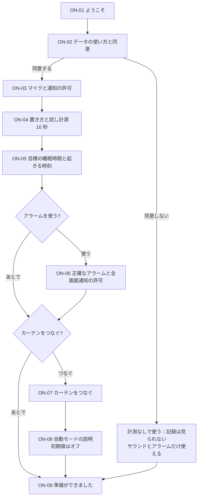

# UX-1 初回利用フロー

- 状態：提案
- PRD：6 章の手順 1・2、5.2（同意）、4.5（自動モードは初期値オフ）
- モック：v2 の「ON-02 同意」「BR-02 カーテンをつなぐ」

## 1. 方針

- **必須は 4 画面だけ**（ようこそ、同意、マイクの許可、置き方）。それ以外は「あとで」で飛ばせ、設定からいつでも戻れる。
- 入力は選ぶだけにする。文字を打つのはカーテンのトークンだけで、それも貼り付けで済ませる。
- 許可を求める前に、**何のために使うか**を 1 画面で説明する（OS の確認画面がいきなり出ないようにする）。
- 断られても先に進める。できなくなることを 1 行で伝え、あとで許可する方法を示す。

## 2. 流れ

## 3. 画面ごとの内容

| ID | 画面 | 内容 | 入力 | 飛ばせるか |
|---|---|---|---|---|
| ON-01 | ようこそ | アプリでできること 3 つ（眠りを記録して振り返る／寝室を整える／寝つきと目覚めを助ける） | 「はじめる」 | — |
| ON-02 | データの使い方と同意 | 下の 4 章の表をそのまま表示。プライバシーポリシーへのリンク（`SDL_OpenURL`） | 「同意して計測を使う」「同意しないで続ける」 | 同意しない選択あり |
| ON-03 | マイクと通知の許可 | マイク：いびきと寝室の音のため（録音は保存しない）／通知：計測中の表示とアラームのため。ボタンを押すと OS の確認画面（`SDL_RequestAndroidPermission`） | 「許可する」 | 拒否しても進める（Q01 の表示になる） |
| ON-04 | 置き方と試し計測 | 図：枕元のマットレスの上、画面を上、充電しながら。「試してみる」で 10 秒計測（AI-2 の 4 章）。任意の質問「一人で寝ていますか（はい／いいえ／答えない）」 | 「試してみる」 | 試し計測は飛ばせる |
| ON-05 | 目標と起きる時刻 | 目標の睡眠時間（既定 7 時間、ローラーで 15 分刻み）、起きる時刻（平日・休日）。「おすすめの寝る時刻：23:30」を自動表示 | ローラー | 既定値のままで進める |
| ON-06 | アラームの許可 | 正確な時刻に鳴らすための許可と、ロック中に画面を出す許可。それぞれ「設定を開く」（Kotlin の `SystemSettings`）。戻ってきたら許可の状態を再確認して表示 | 「設定を開く」 | 「アラームを使わない」 |
| ON-07 | カーテンをつなぐ | UX-5 の BR-02 と同じ画面 | 貼り付け、選択 | 「あとで」 |
| ON-08 | 自動モードの説明 | UX-5 の BR-03 の 4 項目を表示。**初期値はオフ**。「有効にする」は確認つき | 「有効にする」「今は使わない」 | 既定は「今は使わない」 |
| ON-09 | 準備完了 | 今夜の流れ（寝る前に「おやすみ」を押す → 朝にスコアとアドバイス） | 「ホームへ」 | — |

## 4. 同意画面（ON-02）に載せる内容

| 項目 | 内容 |
|---|---|
| 取得するもの | 体の動き（加速度センサー）、寝室の音の大きさといびき（マイク）、部屋の明るさ（照度センサー、ある端末のみ） |
| 使い道 | 眠りの記録、スコア、アドバイス、カーテンの設定の提案 |
| 録音 | 保存しない。音は端末の中ですぐ数値に変換して捨てる。録音を残す機能は、設定でオンにした場合だけ（ADR-0010） |
| 保存場所 | この端末の中だけ。暗号化して保存し、サーバーには送らない |
| 保存期間 | 毎日の結果：削除するまで／細かな計測値：90 日 |
| 削除・取り消し | 設定の「データとプライバシー」から、いつでも削除・同意の取り消しができる |
| 医療との関係 | 医療機器ではなく、診断はしない |

同意文には版を付け、変更したら再同意を求める（`consent` テーブル、AI-1 の 8 章）。

## 5. 許可を断られたとき

| 断られたもの | できなくなること | 表示（UX-7） | 戻し方 |
|---|---|---|---|
| マイク | いびき・呼吸音の記録 | ST-PERM-MIC | 設定の「データとプライバシー」→「マイクを許可」（2 回断られた後は OS の設定画面を開く） |
| 通知 | 計測中の表示が出ない。アラームの通知が出ない | ST-PERM-NOTIF | 同上 |
| 正確なアラーム | アラームと自動モード | ST-PERM-EXACT-ALARM | アラームの画面の警告から「設定を開く」 |
| 全画面通知 | ロック中に鳴動画面が出ない（音は鳴る） | ST-PERM-FSI | 同上 |

## 6. LVGL での作り方

- 9 画面を 1 つの「ウィザード」部品にまとめる。上部に進み具合（`lv_bar`、必須の画面だけ数える）、下部に主ボタンと「あとで」。
- ローラーは `lv_roller`（時と分を 2 本）。
- 許可の結果は SDL のイベントで受け取り、UI スレッドで画面を更新する（platform-boundary.md の 6 章）。
- PC 版では許可はすべて「許可」として進む。断られた場合の画面は、デバッグ設定で状態を切り替えて確認する（ADR-0011）。
