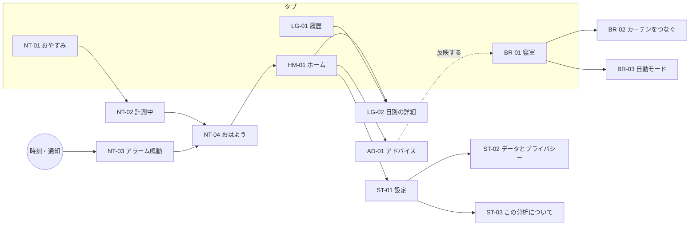

# UX-2 情報設計

- 状態：提案
- PRD：4.3（ダッシュボードとログは別画面）、5.1（操作を最小限に）

## 1. タブの構成

| タブ | 役割 | 主な画面 | 主に使う時間帯 |
|---|---|---|---|
| **ホーム** | 昨夜の結果とアドバイスを見る | HM-01、AD-01 | 朝 |
| **履歴** | 過去の日付を選んで比べる | LG-01、LG-02 | いつでも |
| **おやすみ** | サウンド・アラーム・計測を始める | NT-01 → NT-02 | 夜 |
| **寝室** | カーテンと自動モード | BR-01〜03 | 夜・朝 |

設定はホームの右上の歯車から開く（ST-01〜04）。PRD 4.3 の「ログは別画面」に合わせ、ホーム（ダッシュボード）と履歴（ログ）を分けた。

UI モック v1 との違い：v1 の「記録」タブ（手入力）は廃止した。センサーで自動記録するため（ADR-0005）。v1 の「アドバイス」タブはホームの下の階層（AD-01）に移した。

## 2. 画面一覧

| ID | 画面 | 開く場所 | 関係する状態（UX-7） |
|---|---|---|---|
| ON-01〜09 | 初回設定 | 初回起動 | — |
| HM-01 | ホーム | タブ | EMPTY-FIRST、SAVING、ANALYZING、ANALYSIS-FAILED、INSUFFICIENT、PARTIAL-GAP |
| AD-01 | アドバイスの一覧 | ホームの「すべて見る」 | NOT-ENOUGH-NIGHTS |
| LG-01 | 履歴 | タブ | EMPTY-DAY |
| LG-02 | 日別の詳細 | LG-01 の日付・棒、HM-01 の「詳しく見る」 | INSUFFICIENT、PARTIAL-GAP |
| NT-01 | おやすみ | タブ、ホームの主ボタン | PERM-MIC、BATTERY-LOW、PERM-EXACT-ALARM |
| NT-02 | 計測中 | NT-01 の「計測をはじめる」、計測中の通知 | TRACKING、TRACKING-INTERRUPTED |
| NT-03 | アラーム鳴動 | 全画面通知、アラームの通知 | CURTAIN-PENDING |
| NT-04 | おはよう | NT-03 の「止める」、NT-02 の「起きた」 | SAVING、ANALYZING |
| BR-01 | 寝室 | タブ | CURTAIN-* 、AUTO-PAUSED |
| BR-02 | カーテンをつなぐ | BR-01、ON-07 | CURTAIN-AUTH、CURTAIN-OFFLINE |
| BR-03 | 自動モードを有効にする | BR-01、ON-08 | — |
| ST-01 | 設定 | ホームの歯車 | — |
| ST-02 | データとプライバシー | ST-01 | — |
| ST-03 | この分析について | ST-01、段階の帯の「?」 | — |
| ST-04 | ライセンス表示 | ST-01 | — |

## 3. 遷移

## 4. 戻る操作

| 画面 | Android の戻るボタン |
|---|---|
| タブの最上位 | ホーム以外ならホームへ。ホームならアプリを閉じる（SDL の既定の動き） |
| 下の階層 | 1 つ上へ |
| NT-02 計測中 | 戻らない（誤って止めないため）。「計測を止める」は長押し |
| NT-03 アラーム鳴動 | 戻らない（止めるかスヌーズを選ぶ） |
| 確認のシート | シートを閉じる（キャンセルと同じ） |

## 5. 通知からの行き先

| 通知 | 行き先 |
|---|---|
| 計測中 | NT-02 |
| アラーム | NT-03 |
| カーテンの失敗・未確認 | BR-01（結果の行を強調） |
| 自動モードの一時停止 | BR-01 |
| おやすみの通知 | NT-01 |

## 6. LVGL での作り方

- 画面ごとに `lv_obj` を 1 つ作り、`lv_screen_load_anim` で切り替える。タブバーは画面ごとに置かず、最上位の層（`lv_layer_top`）に 1 つだけ置く。
- 画面は「作る・更新する・捨てる」の 3 関数を持つ部品にし、データの更新は「更新する」だけで行う（画面を作り直さない）。
- 下の階層への移動と戻る操作は、画面 ID のスタックで管理する（`ui/` の中）。
- PC 版のデバッグ設定で、任意の画面 ID と状態を直接開けるようにする（ADR-0011 の段 4）。
